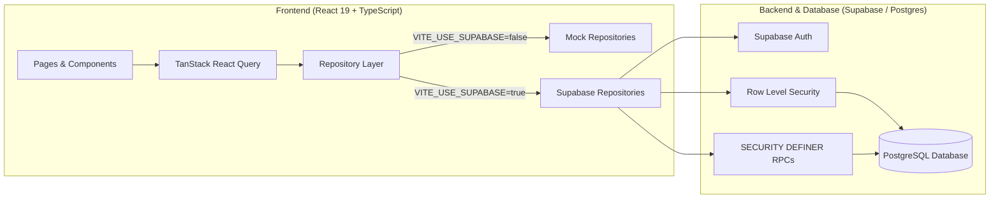
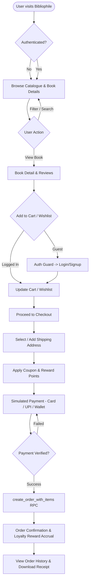

# Bibliophile — Full-Stack e-Book Store Capstone

[](https://vitejs.dev/)
[](https://react.dev/)
[](https://www.typescriptlang.org/)
[](https://tailwindcss.com/)
[](https://supabase.com/)

**Bibliophile** is a modern, responsive full-stack e-book store capstone application. It provides an end-to-end digital bookstore experience: browsing and searching catalogues, managing wishlists and carts, applying discounts and loyalty points, processing simulated payments, and tracking order history with rock-solid server-side database integrity and security.

---

## 📑 Table of Contents

- [Key Features](#-key-features)
- [Architecture & Tech Stack](#-architecture--tech-stack)
- [Project Structure](#-project-structure)
- [Database & Migrations](#-database--migrations)
- [Getting Started](#-getting-started)
  - [Prerequisites](#prerequisites)
  - [Installation & Setup](#installation--setup)
  - [Database Setup](#database-setup)
- [Available Scripts](#-available-scripts)
- [Testing & Quality Assurance](#-testing--quality-assurance)
- [Security & Business Rules](#-security--business-rules)
- [Workflow Diagram](#-workflow-diagram)

---

## 🌟 Key Features

### 📖 Storefront & Discovery
- **Catalogue & Search**: Search books by title, author, or genre with real-time filtering, sorting, and pagination.
- **Showcase Sections**: Dedicated sections for *Bestsellers*, *New Releases*, and *Top Rated* books.
- **Book Details & Recommendations**: Rich book pages with metadata, customer reviews, ratings, and contextual book recommendations.

### 🛒 Cart & Wishlist
- **Persistent Cart & Wishlist**: Integrated with Supabase PostgreSQL and Row Level Security (RLS).
- **Optimistic UI Updates**: Instant feedback on user actions backed by TanStack React Query.
- **Dual Mode Support**: Seamless toggle between in-memory mock repositories and real Supabase backend.

### 💳 Checkout & Loyalty
- **Step-by-Step Checkout**: Linear flow across Address selection, Coupon/Reward redemption, and Payment.
- **Coupons & Reward Points**: Apply discount coupons and redeem accrued loyalty points towards total order amounts.
- **Simulated Multi-Method Payment**: Simulated transactions for Credit/Debit Cards, UPI, and Digital Wallets with idempotency protection.

### 👤 User Profile & Order Management
- **Supabase Authentication**: Email and password authentication with secure session management.
- **Order History & Receipts**: Detailed view of past orders, item breakdowns, status tracking, and receipt views.
- **Profile & Rewards**: User profile management showing current reward-points balance and account details.

---

## 🏗 Architecture & Tech Stack



### Technology Highlights

- **Frontend**: [React 19](https://react.dev/), [TypeScript 6](https://www.typescriptlang.org/), [Vite 8](https://vitejs.dev/)
- **Styling**: [TailwindCSS v4](https://tailwindcss.com/)
- **State Management & Data Fetching**: [TanStack React Query v5](https://tanstack.com/query)
- **Routing & Forms**: [React Router DOM v7](https://reactrouter.com/), [React Hook Form](https://react-hook-form.com/)
- **Backend as a Service**: [Supabase](https://supabase.com/) (PostgreSQL, Supabase Auth, Row Level Security, Pl/pgSQL RPCs)
- **Testing & Tooling**: [Vitest](https://vitest.dev/), [Testing Library](https://testing-library.com/), [ESLint](https://eslint.org/), [Prettier](https://prettier.io/)

---

## 📁 Project Structure

```
e-book-store-capstone/
├── e-book-store-fe/              # Frontend React application
│   ├── src/
│   │   ├── components/           # Shared UI and feature components
│   │   ├── context/              # Context providers (AuthContext, etc.)
│   │   ├── hooks/                # React Query hooks (data fetching & mutations)
│   │   ├── lib/                  # Utilities (pricing, validation, logger, Supabase client)
│   │   ├── pages/                # Page route components
│   │   ├── repositories/         # Repository pattern (mock vs Supabase implementations)
│   │   │   ├── mock/             # In-memory mock data repositories
│   │   │   └── supabase/         # Supabase client data repositories
│   │   ├── services/             # Domain & business logic
│   │   ├── test/                 # Vitest test suite
│   │   └── types/                # TypeScript domain models and interfaces
│   ├── package.json
│   └── vite.config.ts
├── supabase/
│   └── migrations/               # Sequential SQL migrations (001 to 020)
├── docs/                         # Documentation, AI prompt logs & workflow diagrams
└── README.md                     # Root project documentation
```

---

## 🗄 Database & Migrations

All schema and database logic are version-controlled in `supabase/migrations/` and applied sequentially:

| Migration | Purpose |
|---|---|
| `001_catalogue_schema.sql` | Books, authors, genres, and book review tables |
| `002_catalogue_indexes.sql` | Search and performance indexes |
| `003_catalogue_rls.sql` | RLS policies for public catalogue reading |
| `004_average_rating_trigger.sql` | Automatic calculation trigger for book ratings |
| `005_seed_data.sql` | Initial seed books, categories, and inventory |
| `006–007_wishlists_*.sql` | User wishlist schema and user-scoped RLS policies |
| `008–010_carts_*.sql` | Shopping cart and coupon schemas with RLS |
| `011–014_checkout_*.sql` | Addresses, orders, payments schema and RLS |
| `015_create_order_rpc.sql` | Initial atomic order creation procedure |
| `016_payment_idempotency_*.sql`| Payment idempotency key and confirmation triggers |
| `017_cancel_order_rpc.sql` | SECURITY DEFINER procedure for order cancellations |
| `018_create_order_rpc_server_prices.sql` | Server-side price calculation, coupon validation & rewards enforcement |
| `019_coupon_rls_restrict.sql` | Restricts coupon queries to active and unexpired vouchers |
| `020_profiles_schema.sql` | User profiles, reward points tracking & auto-provisioning triggers |

---

## 🚀 Getting Started

### Prerequisites

- **Node.js**: `≥ 20.x`
- **npm**: `≥ 10.x`
- **Supabase Account**: (Optional if running with mock repository mode)

### Installation & Setup

1. **Clone the repository**:
   ```bash
   git clone <repository-url>
   cd e-book-store-capstone
   ```

2. **Install frontend dependencies**:
   ```bash
   cd e-book-store-fe
   npm install
   ```

3. **Configure Environment Variables**:
   Copy the example environment file inside `e-book-store-fe`:
   ```bash
   cp .env.example .env.local
   ```
   Configure your `.env.local`:
   ```env
   VITE_SUPABASE_URL=https://<your-project-id>.supabase.co
   VITE_SUPABASE_ANON_KEY=<your-anon-key>
   VITE_USE_SUPABASE=true
   ```
   > **Note**: Set `VITE_USE_SUPABASE=false` to run fully offline using in-memory mock repositories without Supabase credentials.

### Database Setup

To push migrations to your Supabase project:

```bash
# Using Supabase CLI
npx supabase db push --project-id <your-project-id>

# Or execute migrations 001 through 020 in order using the Supabase SQL Editor
```

Start the local development server:
```bash
npm run dev
```
Open [http://localhost:5173](http://localhost:5173) in your browser.

---

## 🛠 Available Scripts

Inside `e-book-store-fe/`:

| Script | Command | Description |
|---|---|---|
| **Dev Server** | `npm run dev` | Starts Vite dev server with Hot Module Replacement (HMR) |
| **Build** | `npm run build` | Runs TypeScript compilation (`tsc -b`) and produces production bundle |
| **Preview** | `npm run preview` | Runs local web server to preview production build |
| **Typecheck** | `npm run typecheck` | Fast TypeScript type checking without emitting files |
| **Lint** | `npm run lint` | Lints codebase using ESLint |
| **Format** | `npm run format` | Auto-formats code with Prettier |
| **Format Check**| `npm run format:check` | Validates formatting rules (CI ready) |
| **Test** | `npm run test` | Executes unit and component tests with Vitest |
| **Test Watch** | `npm run test:watch` | Runs Vitest in watch mode |
| **Test Coverage**| `npm run test:coverage`| Generates test coverage report |
| **Generate Types**| `npm run gen:types` | Regenerates `database.types.ts` from live Supabase schema |

---

## 🔒 Security & Business Rules

1. **Row Level Security (RLS)**: Enforced on all user tables (`carts`, `wishlists`, `addresses`, `orders`, `payments`, `profiles`). Users can only query and mutate their own data.
2. **Server-Side Price Validation**: Final prices, coupon discounts, and reward-point deductions are computed within the `create_order_with_items` PostgreSQL `SECURITY DEFINER` RPC. Client-supplied price payloads are strictly not trusted.
3. **Payment Idempotency**: Payment attempts use idempotency keys to prevent double-charging and duplicate order records.
4. **Environment Isolation**: Public keys (`VITE_SUPABASE_ANON_KEY`) are scoped strictly to public/RLS-guarded queries. Secrets like `service_role` are never included in the client bundle.

---

## 🔄 Workflow Diagram



---

## 📄 License

This project is created as a capstone application. All rights reserved.
