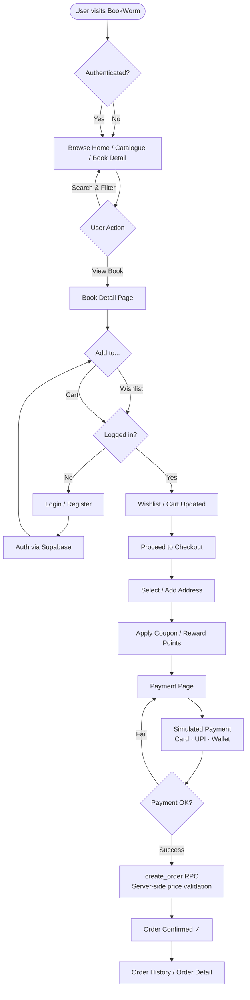

# BookWorm — High-Level Workflow Diagram

## Flow Summary

| Stage | Detail |
|---|---|
| **Browse** | Home, Catalogue, Book Detail — open to all users, no login required |
| **Auth Gate** | Wishlist, Cart, Checkout, Orders and Profile are protected by `AuthGuard` |
| **Login / Register** | Email + password via Supabase Auth; redirected back after sign-in |
| **Checkout** | Linear 3-step funnel — Address → Coupon/Rewards → Payment |
| **Payment** | Simulated client-side (`paymentSimulator.ts`) — Card, UPI, Wallet |
| **Order Creation** | Committed via `create_order` RPC; server re-validates prices from DB |
| **Post-Order** | Confirmation page → Order History / Order Detail |
