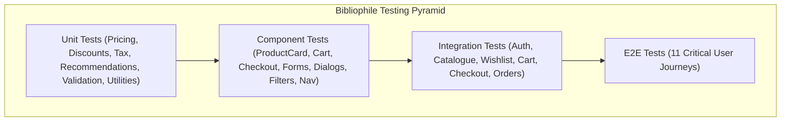
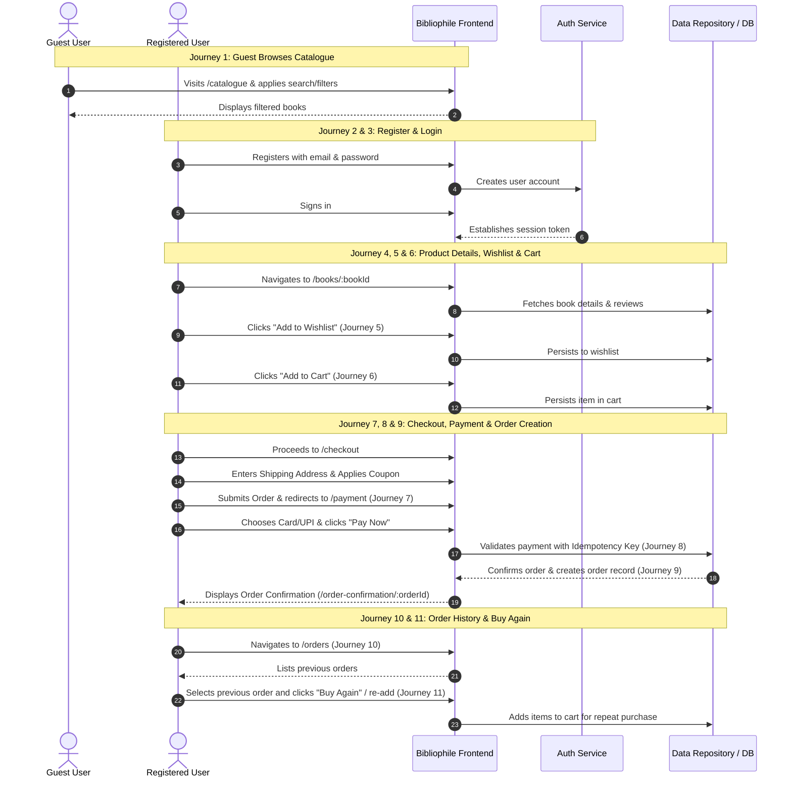

# Complete Testing Strategy & Quality Assurance Plan for Bibliophile

## Top-Level Overview

This document outlines the testing strategy for Bibliophile, covering Unit, Component, Integration, and End-to-End (E2E) testing layers. It evaluates current test coverage against requirements, establishes testing standards, identifies testing gaps, and prioritizes critical user journeys.

---

## 1. Test Architecture & Framework Alignment

- **Test Runner & Assertion Engine**: Vitest v4
- **DOM / Component Testing**: `@testing-library/react` + `@testing-library/jest-dom` + `jsdom`
- **Mocking & Isolation**: Vitest `vi.fn()`, `vi.spyOn()`, in-memory mock repositories (`MockBookRepository`, `MockCartRepository`, `MockWishlistRepository`, `MockOrderRepository`, `MockAddressRepository`), and Mock Auth provider wrappers
- **E2E Tooling Candidate**: Playwright / Cypress (or simulated multi-step full-flow Vitest integration tests in jsdom)

---

## 2. Test Coverage Matrix by Layer

### Layer 1: Unit Testing

Unit tests validate pure business logic, mathematical precision, domain algorithms, data normalization, and input validation without rendering UI or accessing live external services.

| Domain / Target | Test Scenarios & Cases | Current Status | Priority |
| :--- | :--- | :--- | :--- |
| **Price Calculations** (`pricing.ts`) | • Subtotal computation with single/multiple items • Zero-quantity items • Empty cart handling • Price formatting (`formatPrice`, `formatPriceDecimal`) with INR currency symbols | Covered in `pricing.test.ts` (46 tests) | **P0 - Critical** |
| **Discounts & Coupons** (`pricing.ts`) | • Flat discount deductions (e.g. ₹50 off) • Percentage discount deductions (e.g. 10% off) • Discount exceeding subtotal (flooring at 0) • Min order value thresholds • Inactive / expired coupon rejection | Covered in `pricing.test.ts` | **P0 - Critical** |
| **Tax Computations** (`pricing.ts`) | • GST 12% calculation on discounted subtotal • Rounding precision to 2 decimal places • Zero-tax edge cases | Covered in `pricing.test.ts` | **P0 - Critical** |
| **Reward Points Discount** (`pricing.ts`) | • 100 points = ₹10 conversion rate • Max 20% cap of post-coupon subtotal • Partial points application • Excess points clamping | Covered in `pricing.test.ts` | **P1 - High** |
| **Recommendation Engine** (`scoring.ts`, `CatalogueRecommendationService.ts`) | • Same author match weighting (40 pts) • Category overlap scoring (30 pts) • Bestseller / popular boost (20 pts) • Rating weight (10 pts) • Self-exclusion of active book • Limit capping and deterministic ties | Covered in `recommendations.test.ts` (22 tests) | **P1 - High** |
| **Form Validation Helpers** | • Address validation: 6-digit PIN code, 10-digit phone number, mandatory street/city/state (`validateAddress.ts`) • Payment validation: 16-digit card number, MM/YY expiry, 3-digit CVV, UPI VPA format (`validatePayment.ts`) • Cart items validation: active book presence, positive quantity (`validateCartItems.ts`) | Covered across `checkout.test.ts`, `payment.test.ts` | **P0 - Critical** |
| **Utility Functions** | • Structured logger sanitization for passwords, CVV, cards, tokens (`logger.test.ts`) • Safe redirect URL validator (`auth.test.tsx`) • Error taxonomy classification & user sanitization (`errors.test.ts`) • Network online/offline status hook (`useOnlineStatus.test.ts`) | Covered in `logger.test.ts`, `errors.test.ts`, `useOnlineStatus.test.ts` | **P1 - High** |

---

### Layer 2: Component Testing

Component tests verify isolated UI behavior, accessibility (`aria-*`, keyboard nav), form validation feedback, error banners, loading skeletons, and interactive state changes using React Testing Library.

| Component | Target Scenarios | Verification Points | Priority |
| :--- | :--- | :--- | :--- |
| **ProductCard** | • Vertical & Horizontal card variants • Missing cover image placeholder • Rating stars & review count badge • Bestseller / New Launch badges • Sale price vs original price strike-through | Render structure, responsive layout classes, fallback image handling | **P1 - High** |
| **Cart View Components** | • Quantity increment / decrement buttons • Disable stepper while pending mutation • Item remove button trigger • Coupon input field + Apply button state • Price breakdown summary lines • Empty cart CTA button | Stepper triggers `onQtyChange`, coupon feedback renders `role="alert"`, empty state navigation | **P0 - Critical** |
| **Checkout Components** | • `AddressForm` field binding & inline error alerts • `AddressPickerModal` saved addresses selection • `RewardPointsToggle` dynamic slider/checkbox • Sticky Order Summary sidebar | Accessible labels, keyboard focus trapping in modal, disabled submit during pre-flight | **P0 - Critical** |
| **Forms (Auth & Reviews)** | • `LoginForm` required inputs & error alerts • `RegisterForm` password confirmation match check • `ReviewsSection` star rating selector + review text area validation | Native validation prevention, aria-invalid flags, error message rendering | **P0 - Critical** |
| **Dialogs & Modals** | • `AddressPickerModal` • Confirmation Dialogs • `Modal` backdrop click & Escape key close | `role="dialog"`, `aria-modal="true"`, focus trap, clean unmount | **P1 - High** |
| **Catalogue Filters** | • `CatalogueFiltersBar` search input debouncing • Language, format, price range selects • Publisher dropdown filter • `CategorySidebar` active selection highlight • Reset filters button | Event emission with updated filter criteria, accessibility | **P1 - High** |
| **Navigation & Layout** | • `Navbar` active route indicator • Cart badge counter reflects cart item count • Auth state switch (Sign in link vs Account/Sign Out icon buttons) • `RouteChangeAnnouncer` live region • Skip-to-content link | Screen reader live announcements, link destinations, focus reset | **P1 - High** |

---

### Layer 3: Integration Testing

Integration tests verify data orchestration between React components, custom hooks, React Query cache, and Repositories (both in-memory mock and Supabase backends).

| Domain | Scope & Workflows Tested | Key Assertions & Side Effects | Priority |
| :--- | :--- | :--- | :--- |
| **Authentication Integration** | • Sign in with valid credentials updates `AuthContext` • Invalid credentials display friendly error alert • Sign out clears session & invalidates React Query cache • `AuthGuard` redirects unauthenticated user preserving return URL | Context state transition, storage updates, redirect query params | **P0 - Critical** |
| **Catalogue Integration** | • Filter changes update query parameters and refetch book lists • Category navigation triggers category-filtered query • Search text queries matching books • Empty search results trigger `<EmptyState />` | Query key generation, cache invalidation, presentation updates | **P1 - High** |
| **Wishlist Integration** | • Add to wishlist optimistically updates heart icon and cache • Remove from wishlist removes item and reflects in list query • Mutation failure triggers cache rollback and alert banner • Move to Cart transfers item between repositories | Optimistic cache consistency, rollback on error, cross-repository data flow | **P1 - High** |
| **Cart Integration** | • Adding book increments quantity or adds new cart row • Stepper updates quantity and recalculates totals live • Clear cart empties cart store and cache • Stale price / stock pre-flight check detects disparities | React Query `cartKeys` invalidation, subtotal recalculation | **P0 - Critical** |
| **Checkout & Order Integration** | • Address form submission saves/selects shipping address • Coupon server revalidation before order creation • Atomic order + order items creation via repository RPC • Post-order cart cleanup trigger | Transactional integrity, pricing snapshot in `order_items`, cart cache clearance | **P0 - Critical** |
| **Order History & Detail** | • Orders list queries user's orders sorted by date desc • Order detail queries order items, shipping snapshot, and payment status • Unauthorized order access returns 404/Not Found state • Order cancellation updates status to cancelled | RLS isolation, correct breakdown display | **P1 - High** |

---

### Layer 4: End-to-End (E2E) Critical User Journeys

The 11 prioritized end-to-end user workflows validate seamless traversal of the application from landing to repeat purchase.

#### Detailed E2E Journey Specifications:

1. **Journey 1: Guest Browses Catalogue**
   - **Preconditions**: Unauthenticated guest user on `/` or `/catalogue`.
   - **Steps**: Navigate to catalogue → filter by category "Technology" → search "React" → sort by "Price: Low to High".
   - **Expected Outcome**: Books list updates dynamically, filter tags match selection, URL query params sync correctly.
2. **Journey 2: User Registers**
   - **Preconditions**: Guest user on `/register`.
   - **Steps**: Enter display name, valid email, password, confirm password → Submit.
   - **Expected Outcome**: Account created; either navigates to `/` (auto-confirmed) or displays "Check your email" confirmation screen.
3. **Journey 3: User Logs In**
   - **Preconditions**: Unauthenticated registered user on `/login?next=/cart`.
   - **Steps**: Enter credentials → Submit.
   - **Expected Outcome**: User authenticated, redirected to `/cart` with active session and updated navbar profile icon.
4. **Journey 4: User Views Product Details**
   - **Preconditions**: Any user on `/books/:bookId`.
   - **Steps**: Load page → verify title, author, price, description, reviews list, and related reads panel.
   - **Expected Outcome**: Complete metadata rendered; rating summary reflects review score average.
5. **Journey 5: User Adds Product to Wishlist**
   - **Preconditions**: Authenticated user on product page.
   - **Steps**: Click "Add to Wishlist" heart icon → navigate to `/wishlist`.
   - **Expected Outcome**: Wishlist count increments; saved book appears with correct details and "Move to Cart" button.
6. **Journey 6: User Adds Product to Cart**
   - **Preconditions**: Authenticated user.
   - **Steps**: Click "Add to Cart" on book detail page or catalogue card → navigate to `/cart`.
   - **Expected Outcome**: Cart icon badge updates; cart item list contains book with quantity 1 and correct price breakdown.
7. **Journey 7: User Checks Out**
   - **Preconditions**: User has ≥ 1 item in cart.
   - **Steps**: Navigate to `/cart` → click "Proceed to Checkout" → fill shipping address form or pick saved address → apply valid coupon code → toggle reward points redemption → click "Place Order / Pay Now".
   - **Expected Outcome**: Pre-flight validation passes, atomic order is drafted, user is redirected to `/payment` with `orderId`.
8. **Journey 8: Payment Processing & Idempotency**
   - **Preconditions**: Order in pending status on `/payment`.
   - **Steps**: Select Payment Method (Credit Card / UPI / Wallet) → fill payment details → click "Pay Now" → simulator processes payment.
   - **Expected Outcome**: Payment record created with unique idempotency key; order status advances to `confirmed`.
9. **Journey 9: Order Confirmation & Cart Clearance**
   - **Preconditions**: Payment succeeded.
   - **Steps**: User redirected to `/order-confirmation/:orderId`.
   - **Expected Outcome**: Confirmation view shows confetti / success card, order ID, delivery estimate, and order items. Cart is verified empty (`cart_items` cleared).
10. **Journey 10: User Views Order History**
    - **Preconditions**: Authenticated user with past orders.
    - **Steps**: Navigate to `/orders` → click on specific order to view `/orders/:orderId`.
    - **Expected Outcome**: Lists all past orders with status badges (`confirmed`, `shipped`, `delivered`), totals, and date stamps.
11. **Journey 11: User Buys Again (Repeat Purchase)**
    - **Preconditions**: Authenticated user on `/orders` or past order detail.
    - **Steps**: Click "Buy Again" or "Reorder" for an item in previous order history.
    - **Expected Outcome**: Item added to cart, user redirected to `/cart` ready for immediate checkout.

---

## 3. Prioritized Implementation Roadmap

- **Phase 1 (Critical Path - P0)**: Complete Unit & Integration coverage for Pricing, Cart mutations, Address validation, and Order creation RPC.
- **Phase 2 (User Experience - P1)**: Component tests for Forms, Filter Bar, Modals, Product Cards, and Navigation Live Regions.
- **Phase 3 (End-to-End - P0/P1)**: Automated E2E test runner covering Journeys 1 through 11.
- **Phase 4 (Regression & CI/CD - P2)**: Coverage reporting thresholds, accessibility audits (`axe-core`), and CI pipeline integration.
